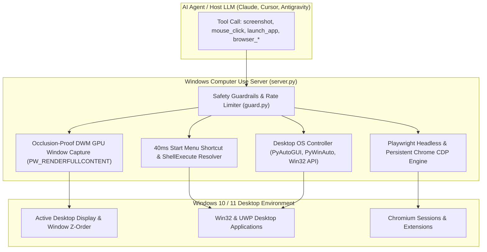

# 🪟 Windows Computer Use & Browser FastMCP Server

[](https://modelcontextprotocol.io/)
[](https://python.org)
[](https://playwright.dev/)
[](https://microsoft.com)
[](LICENSE)

An enterprise-grade Model Context Protocol (MCP) server providing deep Windows desktop operating system control and browser automation. Eliminates occlusion bugs via direct DWM GPU composition buffer capture and resolves Start Menu apps in under 40 milliseconds.

---

## 📐 System Architecture



---

## 🌟 Key Capabilities

1. **Turbo Multi-Action Browser Batching (`browser_batch`):**
   * Eliminates multi-turn LLM latency by executing an entire pipeline (navigation, clicks, fills, keys, waits, extraction) in a single synchronous call (<100ms total).

2. **15ms Interactive Element Snapshot (`browser_snapshot`):**
   * Extracts visible actionable elements (buttons, inputs, links, forms) with ready-to-use CSS selectors directly from the DOM, matching the speed and precision of built-in agent browsers.

3. **Instant JavaScript Evaluation (`browser_eval`):**
   * Direct in-page execution (<3ms) for rapid scraping, DOM updates, and custom element interaction without actionability wait delays.

4. **Native Win32 <2ms Window Enumeration:**
   * Replaced slow COM UIAutomation scans with native Win32 `EnumWindows` and `guard.resolve_real_process`, speeding up window detection and app focusing by over 500x.

5. **Occlusion-Proof DWM Window Capture & Compressed Screenshots:**
   * Direct DWM GPU composition buffer capture via `PrintWindow(PW_RENDERFULLCONTENT)` and high-speed JPEG compression (~100KB payload) for instant vision token transport.

6. **40ms Start Menu App Resolver:**
   * Instant app launching via indexed Windows Start Menu shortcuts and ShellExecute without recursive filesystem crawling.

7. **Multi-Layer Audit Guardrails:**
   * In-memory fast-path rate limiting, desktop attachment validation, and append-only audit trail logging (`audit.log`).

---

## 🛠️ MCP Tool Reference

### High-Speed Browser Suite
* `browser_batch`: Run multiple browser steps in one single turn (goto, click, fill, press, wait, scroll, eval, extract).
* `browser_snapshot`: Instant (<15ms) structured extraction of all interactive elements & CSS selectors.
* `browser_eval`: Execute arbitrary JavaScript directly inside the active web page.
* `browser_load_multiple`: Rapidly load multiple websites across browser tabs with lightning fast 'commit' strategy.
* `browser_new_tab`: Open a new tab in the active browser session.
* `browser_list_tabs`: List all open tabs with URLs, titles, and active status.
* `browser_switch_tab`: Switch active tab focus by index in <5ms.
* `browser_close_tab`: Close a specific tab or active tab.
* `browser_press_key`: Keyboard key presses inside the browser (`Enter`, `Tab`, `Escape`, `ArrowDown`).
* `browser_scroll`: Smooth browser scrolling (`up`, `down`, `top`, `bottom`).
* `browser_open`: Open or attach to browser (isolated sandbox or personal Chrome profile/CDP) with `wait_until` option.
* `browser_navigate`: Fast URL navigation with immediate DOMContentLoaded return.
* `browser_click`: Click elements with 3500ms default timeout and `force=True` actionability bypass.
* `browser_type`: Instant input typing or clearing.
* `browser_screenshot`: Optimized JPEG/PNG viewport or full-page capture.
* `browser_get_content`: Fast readable text extraction.
* `browser_open_extension`: Dedicated persistent tab for Chrome extension popups.
* `browser_close`: Clean session shutdown and resource cleanup.

### Desktop OS Control
* `focus_multiple_apps`: Rapidly cycle focus through multiple desktop applications in sequence.
* `focus_window`: Brings targeted window to foreground in <5ms.
* `list_windows`: Lists all top-level windows in <2ms.
* `screenshot`: Capture full desktop or specific window handle via DWM.
* `mouse_click`: Click relative to targeted window coordinates (instant Win32 resolution).
* `type_text`: Keyboard keystrokes with clipboard paste acceleration for long text.
* `press_key`: Single key press (`enter`, `tab`, `esc`).
* `hotkey`: Key combinations (`Ctrl+C`, `Alt+Tab`, `Win+R`, etc.).
* `launch_app`: Launches Win32 / UWP apps instantly via Start Menu resolution.

---

## 🚀 Installation & Configuration

### Connect to Antigravity / Claude Desktop:

Add to your `mcp_servers` configuration:

```json
{
  "win-computer-mcp": {
    "command": "python",
    "args": [
      "C:\\path\\to\\win-computer-mcp\\server.py"
    ]
  }
}
```

---

## ⚖️ Intellectual Property & License

**Copyright (c) 2026 Kartik. All Rights Reserved.**

This repository and its source code are published for **viewing, evaluation, and portfolio demonstration purposes only**. No permission is granted to reproduce, distribute, modify, deploy, or commercially exploit this software. See the [LICENSE](LICENSE) file for complete legal terms.
