# 🪟 Windows Computer Use & Browser FastMCP Server

[](https://modelcontextprotocol.io/)
[](https://python.org)
[](https://playwright.dev/)
[](https://microsoft.com)
[](LICENSE)

An enterprise-grade Model Context Protocol (MCP) server providing deep Windows desktop operating system control and browser automation. Eliminates occlusion bugs via direct DWM GPU composition buffer capture and resolves Start Menu apps in under 40 milliseconds.

---

## 📐 System Architecture

```mermaid
flowchart TD
    subgraph Client_AI ["AI Agent / Host LLM (Claude, Cursor, Antigravity)"]
        ToolCall["Tool Call: screenshot, mouse_click, launch_app, browser_*"]
    end

    subgraph FastMCP_Server ["Windows Computer Use Server (server.py)"]
        Guard["Safety Guardrails & Rate Limiter (guard.py)"]
        DWM["Occlusion-Proof DWM GPU Window Capture (PW_RENDERFULLCONTENT)"]
        AppResolver["40ms Start Menu Shortcut & ShellExecute Resolver"]
        PyWin["Desktop OS Controller (PyAutoGUI, PyWinAuto, Win32 API)"]
        BrowserSuite["Playwright Headless & Persistent Chrome CDP Engine"]
    end

    subgraph Target_OS ["Windows 10 / 11 Desktop Environment"]
        Display["Active Desktop Display & Window Z-Order"]
        Apps["Win32 & UWP Desktop Applications"]
        Browser["Chromium Sessions & Extensions"]
    end

    ToolCall --> Guard
    Guard --> DWM
    Guard --> AppResolver
    Guard --> PyWin
    Guard --> BrowserSuite

    DWM --> Display
    AppResolver --> Apps
    PyWin --> Apps
    BrowserSuite --> Browser
```



---

## 🌟 Key Capabilities

1. **Occlusion-Proof DWM Window Capture:**
   * Utilizes Win32 `PrintWindow` with `PW_RENDERFULLCONTENT` directly from the DWM composition buffer.
   * Takes clean window screenshots even if overlapping windows (like an IDE or terminal) are physically obscuring the target window.

2. **40ms Start Menu App Resolver:**
   * Replaces slow, recursive hard-drive file searches with an indexed Windows Start Menu and ShellExecute shortcut resolver to launch applications in <40ms.

3. **Unified Playwright Browser Suite:**
   * Supports isolated fast headless sessions, persistent browser profiles, and connection to active Chrome DevTools Protocol (CDP) sessions with Chrome Extension support.

4. **Multi-Layer Audit Guardrails:**
   * Includes `guard.py` for desktop attachment validation, rate limiting, and an append-only audit trail log preventing runaway infinite input loops.

---

## 🛠️ MCP Tool Reference

* `screenshot`: Capture full desktop or specific window handle with DPI awareness.
* `mouse_click`: Left, right, double-click, drag-and-drop with normalized or pixel coordinates.
* `type_text`: Synthesizes keyboard keystrokes into active controls.
* `hotkey`: Key combinations (`Ctrl+C`, `Alt+Tab`, `Win+R`, etc.).
* `launch_app`: Launches Win32 / UWP apps instantly via Start Menu resolution.
* `focus_window`: Brings targeted window to foreground with Z-order priority.
* `browser_open`, `browser_navigate`, `browser_click`, `browser_screenshot`: Full browser control suite.

---

## 🚀 Installation & Configuration

### Connect to Antigravity / Claude Desktop:

Add to your `mcp_servers` configuration:

```json
{
  "win-computer-mcp": {
    "command": "python",
    "args": [
      "C:\\path\\to\\win-computer-mcp\\server.py"
    ]
  }
}
```

---

## ⚖️ Intellectual Property & License

**Copyright (c) 2026 Kartik. All Rights Reserved.**

This repository and its source code are published for **viewing, evaluation, and portfolio demonstration purposes only**. No permission is granted to reproduce, distribute, modify, deploy, or commercially exploit this software. See the [LICENSE](LICENSE) file for complete legal terms.
